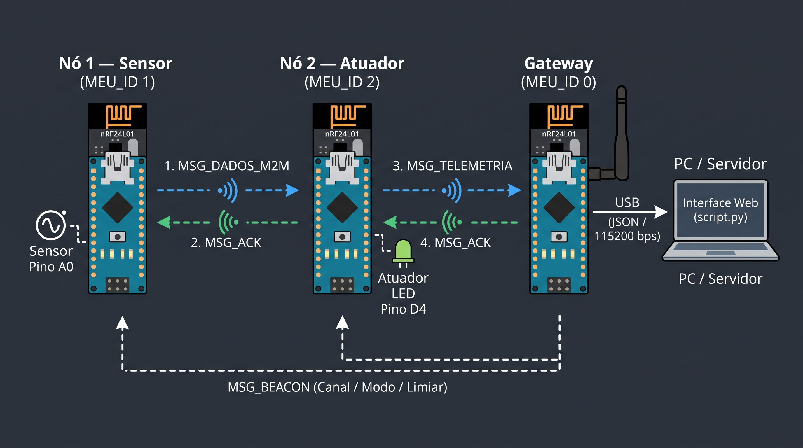
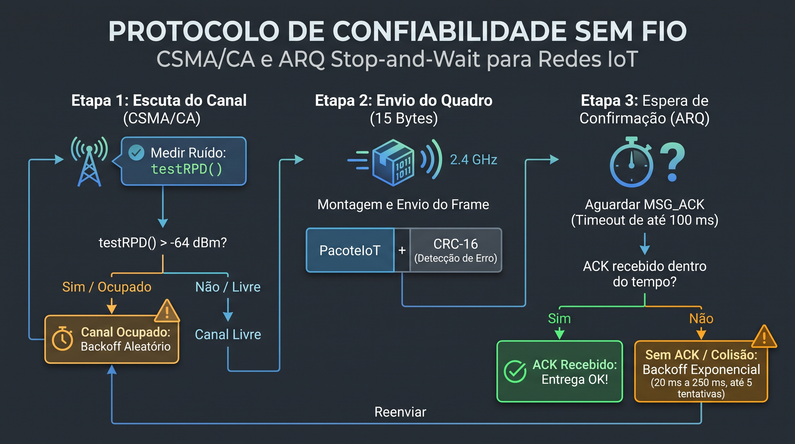
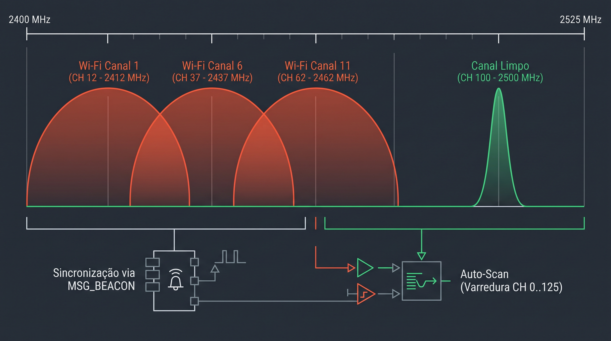

<div align="center">
  
  <br><br>
  <strong>Universidade Tecnológica Federal do Paraná (UTFPR)</strong><br>
  <sub>Disciplina: <strong>OPT101 — Tópicos Especiais Em Interfaces Computacionais</strong></sub>

  <h1>Rede IoT Sem Fios (2,4 GHz) com Controle Autônomo M2M, CSMA/CA, ARQ e Supervisão Web</h1>

  <p>
    
    
    
    
  </p>

  <p>
    <a href="#1-visão-geral-do-projeto">Visão Geral</a> •
    <a href="#2-arquitetura-da-rede-e-papéis-dos-nós">Arquitetura</a> •
    <a href="#3-hardware-pinagem-spi-e-estabilidade-elétrica">Hardware & SPI</a> •
    <a href="#4-anatomia-do-quadro-e-endereçamento">Quadro (15B)</a> •
    <a href="#5-protocolos-de-acesso-ao-meio-e-confiabilidade">CSMA/CA & ARQ</a> •
    <a href="#6-gestão-de-espectro-e-interferência-wi-fi">Espectro Wi-Fi</a> •
    <a href="#7-diagramas-temporais-e-máquinas-de-estado">Temporização</a> •
    <a href="#8-guia-de-operação-da-interface-web">Operação Web</a>
  </p>
</div>

---

## 1. Visão Geral do Projeto

Este projeto implementa uma **rede de sensores e atuadores sem fios na faixa ISM de $2{,}4\text{ GHz}$** utilizando microcontroladores **Arduino Nano (ATmega328P)** e transceptores **nRF24L01+**, integrada a um painel web multi-porta de telemetria e diagnóstico em Python (`script.py`).

A arquitetura combina **controle autônomo máquina-a-máquina (M2M)** — permitindo que o nó sensor acione o nó atuador diretamente sem depender de um computador central — com **supervisão em estrela via Gateway**, oferecendo comando remoto, ajuste dinâmico de limiares e análise experimental de interferência em canais compartilhados com redes Wi-Fi.

| Pilar Técnico | Solução Implementada | Benefício no Enlace |
| :--- | :--- | :--- |
| **Firmware Unificado (`MEU_ID`)** | Código único parametrizado para **Gateway (`0`)**, **Sensor (`1`)** e **Atuador (`2`)** | Garante alinhamento estrito de estrutura de bytes, temporizações e constantes de rádio |
| **Acesso ao Meio (`CSMA/CA`)** | Escuta física via registrador `RPD` ($> -64\text{ dBm}$) + *random backoff* | Evita colisões com rajadas de roteadores Wi-Fi e transmissões simultâneas |
| **Confiabilidade (`ARQ` + `CRC-16`)** | Verificação `CRC-16` em hardware + *Stop-and-Wait* com *backoff* exponencial | Descarta quadros corrompidos e recupera pacotes perdidos em até 5 tentativas |
| **Resiliência de Rede** | Sincronização por `MSG_BEACON` + varredura autônoma (`Auto-Scan` `0..125`) | Reestabelece a comunicação automaticamente após troca de canal ou queda de energia |

> [!NOTE]
> **Documentação Interativa:** O repositório inclui uma página explicativa com simuladores visuais de protocolo e inspetor de bytes em `gateway/static/page.html`, acessível diretamente pelo QR Code exibido no painel de monitoramento.

---

## 2. Arquitetura da Rede e Papéis dos Nós

<p align="center">
  
  <br>
  <sub><em>Figura 1 — Topologia híbrida em dois saltos: enlace direto M2M (Nó 1 → Nó 2), telemetria consolidada (Nó 2 → Gateway) e difusão de controle via Beacons.</em></sub>
</p>

A topologia opera em **dois saltos no sentido ascendente** (telemetria consolidada até o PC) e **difusão direta no sentido descendente** (sincronização de canal, modo e limiar via *broadcast*):

| Identificador | Papel na Rede | Pino Principal | Responsabilidades Operacionais |
| :---: | :--- | :---: | :--- |
| **`MEU_ID 0`** | **Gateway** | `USB` ($115200\text{ bps}$) | Ponte RF $\leftrightarrow$ Serial. Recebe `MSG_TELEMETRIA` do Nó 2, serializa o estado em JSON para o backend Python e difunde `MSG_BEACON` (`destino = 255`). |
| **`MEU_ID 1`** | **Nó Sensor** | `A0` (ADC 10 bits) | Amostra o sinal analógico (`0..1023`) a cada $1200\text{ ms}$ e transmite o quadro `MSG_DADOS_M2M` diretamente ao Nó 2 (`destino = 2`). |
| **`MEU_ID 2`** | **Nó Atuador** | `D4` (Saída Digital) | Confirma recepções com `MSG_ACK`, executa a lógica autônoma no pino `D4` (modo `AUTO`) e encaminha telemetria e métricas (`RPD` e `Retries`) ao Gateway. |

<details>
<summary>📐 <strong>Ver diagrama esquemático do fluxo de mensagens (ASCII)</strong></summary>

```text
+-------------------+    1. MSG_DADOS_M2M (A0)     +-------------------+
|   NÓ 1 (Sensor)   | ---------------------------> |  NÓ 2 (Atuador)   |
|     MEU_ID = 1    | <--------------------------- |     MEU_ID = 2    |
|   Pino A0 (ADC)   |         2. MSG_ACK           |   Pino D4 (Saída) |
+-------------------+                              +-------------------+
         ^                                                |     ^
         |                               3. MSG_TELEMETRIA|     | 4. MSG_ACK
         |                                                v     |
         |         6. MSG_BEACON (Broadcast: 255)  +-------------------+
         +---------------------------------------- |  GATEWAY (Nó 0)   |
                                                   |     MEU_ID = 0    |
                                                   +-------------------+
                                                          |     ^
                                            5. JSON (TX)  |     | 7. Comandos (RX)
                                            (115200 bps)  v     | (LED / CH / LIM)
                                                   +-------------------+
                                                   |  PC (script.py)   |
                                                   |  Interface Web    |
                                                   +-------------------+
```
</details>

---

## 3. Hardware, Pinagem SPI e Estabilidade Elétrica

### Mapa de Conexões (Arduino Nano $\leftrightarrow$ nRF24L01+)

| Pino nRF24L01+ | Pino Arduino Nano | Função no Barramento | Observação Técnica |
| :---: | :---: | :--- | :--- |
| `VCC` | `3.3V` | Alimentação RF | Recomenda-se capacitor de $10\ \mu\text{F}$ entre `3.3V` e `GND` |
| `GND` | `GND` | Referência comum | Malha de terra compartilhada |
| `CE` | `D7` | *Chip Enable* | Seleciona os modos de escuta (RX) e transmissão (TX) |
| `CSN` | `D8` | *Chip Select Not* | Habilita a comunicação no barramento SPI |
| `SCK` | `D13` | *Serial Clock* (SPI) | **Reservado ao barramento SPI** |
| `MOSI` | `D11` | *Master Out Slave In* | Envio de comandos e *payload* (Arduino $\rightarrow$ nRF24) |
| `MISO` | `D12` | *Master In Slave Out* | Leitura de registradores e pacotes (nRF24 $\rightarrow$ Arduino) |
| **Sensor** | `A0` | Entrada Analógica | Leitura de tensão no **Nó 1** (`0..1023`) |
| **Atuador** | `D4` | Saída Digital | Acionamento de carga no **Nó 2** |

> [!IMPORTANT]
> **Integridade Elétrica e SPI:**
> 1. **Não utilize o pino `D13` (`LED_BUILTIN`) como atuador**, pois ele compartilha o clock (`SCK`) do barramento SPI com o rádio.
> 2. **Use resistor limitador ($220\ \Omega$ a $1\text{ k}\Omega$)** em série com qualquer LED ligado ao pino `D4` do Nó 2 para evitar queda na linha de $3{,}3\text{ V}$ durante o acionamento.

### Calibração de Potência e Auto-Recuperação

* **Potência diferenciada (`setPALevel`):** O **Gateway (`MEU_ID 0`)** opera em `RF24_PA_MIN` ($-18\text{ dBm}$) para evitar picos de consumo do módulo com antena externa (`PA+LNA`) no regulador de $3{,}3\text{ V}$ do Nano e impedir saturação de receptores próximos. Os **Nós 1 e 2** operam em `RF24_PA_LOW` ($-12\text{ dBm}$), garantindo margem de sinal $4\times$ maior para atravessar interferências Wi-Fi.
* **Auto-recuperação (`garantirRadioAtivo()`):** A cada iteração do `loop()`, o firmware verifica a conectividade SPI e o registrador de canal do chip; caso uma oscilação elétrica reinicie o transceptor, o rádio é reconfigurado automaticamente em menos de $1\text{ ms}$.

---

## 4. Anatomia do Quadro e Endereçamento

O transceptor opera a **$250\text{ kbps}$** (máxima sensibilidade de recepção, $\approx -94\text{ dBm}$), encapsulando a estrutura binária `PacoteIoT` de **15 bytes** dentro do quadro físico gerenciado pelo hardware:

```text
CAMADA FÍSICA (Controlada pelo Chip nRF24L01+ em 250 kbps)
+-----------+----------------+----------+------------------------+----------+
| Preâmbulo | Endereço Rede  | Controle |   Payload (15 Bytes)   |  CRC-16  |
|  (1 Byte) |   "IOT26" (5B) | (9 bits) |   struct PacoteIoT     | (2 Bytes)|
+-----------+----------------+----------+------------------------+----------+
                     |                                                |
                     v                                                v
          Filtra outras equipes                            Descarta quadro se
          direto no hardware                               ruído alterar 1 bit

DETALHAMENTO DO PAYLOAD — struct PacoteIoT (15 Bytes)
+------+--------+---------+-----+-------+--------+------+--------+--------+---------+---------+
| tipo | origem | destino | seq | canal | atuad. | auto | sensor | limiar | rpdHits | retries |
|  1B  |   1B   |   1B    | 1B  |  1B   |   1B   |  1B  |   2B   |   2B   |   2B   |   2B    |
+------+--------+---------+-----+-------+--------+------+--------+--------+---------+---------+
  1=BCN  0, 1, 2  0, 1, 2  1..255 0..125   0 / 1   0 / 1  0..1023  padrão    ruído    retransm.
  2=M2M           255=ALL                                           500      CSMA       ARQ
  3=TEL
  4=ACK
```

* **Filtro por endereço (`"IOT26"`):** Ambos os *pipes* de escrita e leitura usam a assinatura de 5 bytes `"IOT26"`, descartando na camada física quadros de outras redes na mesma sala.
* **Confirmações endereçadas (`setAutoAck(false)` + `MSG_ACK`):** O *Auto-ACK* nativo foi desativado para evitar colisões simultâneas dos Nós 1 e 2 ao responderem aos *Beacons* em difusão (`destino = 255`). A confirmação é feita por um quadro `MSG_ACK` explícito contendo o `seq` original.
* **Deduplicação com expiração (`pacoteNovo()`):** Compara `seq != ultimoSeqRecebido` com janela de expiração de $3000\text{ ms}$, evitando contabilizar pacotes retransmitidos em duplicidade caso um `MSG_ACK` se perca no retorno.

---

## 5. Protocolos de Acesso ao Meio e Confiabilidade

<p align="center">
  
  <br>
  <sub><em>Figura 2 — Pipeline de confiabilidade em três estágios: escuta física de portadora (CSMA/CA), verificação de integridade (CRC-16) e retransmissão com backoff exponencial (ARQ).</em></sub>
</p>

### Por que CSMA/CA + ARQ em vez de MACA (`RTS/CTS`)?

| Critério | MACA (`RTS / CTS`) | Implementação Adotada (`CSMA/CA + ARQ`) |
| :--- | :--- | :--- |
| **Sobrecarga de controle** | Alta — exige 2 quadros extras antes de cada envio de **15 bytes** | Mínima — escuta física passiva sem ocupar o espectro antes do dado |
| **Comutação RX $\leftrightarrow$ TX** | 4 transições por pacote ($130\ \mu\text{s}$ de PLL cada) | 2 transições por pacote (`DATA` $\rightarrow$ `ACK`) |
| **Interferência Wi-Fi** | Roteadores Wi-Fi não interpretam `RTS/CTS` do nRF24L01+ | `radio.testRPD()` detecta diretamente energia Wi-Fi acima de $-64\text{ dBm}$ |

<details>
<summary>📐 <strong>Ver fluxograma completo da função <code>enviarConfiavel()</code> (ASCII)</strong></summary>

```text
                         [ Início: enviarConfiavel(pkt) ]
                                        |
                                        v
                        cw = 20 ms | tentativa = 0 (máx 5)
                                        |
              +------------------------>+
              |                         v
              |             +-----------------------+
              |             |     canalLivre()      |  <-- CSMA/CA: 6 leituras
              |             |   (testRPD > -64dBm)  |      espaçadas de 40 us
              |             +-----------------------+
              |                |                 |
              |            [Ocupado]          [Livre]
              |                |                 |
              |                v                 v
              |         totalRpdHits++     enviarRaw(pkt)
              |         delay(rand(5,cw))   (TX por 130 us)
              |         (até 6 esperas)          |
              |                |                 v
              |                +--------> +---------------+
              |                           | aguardarAck() | <-- Escuta por 100 ms
              |                           | (até 100 ms)  |     (se chegar Beacon,
              |                           +---------------+      atualiza canal/modo)
              |                              |         |
              |                         [Timeout]  [MSG_ACK OK]
              |                              |         |
              |                              v         v
              |                     totalRetries++   [ Retorna TRUE ]
              |                     delay(rand(15,cw))
              |                     cw = min(cw*2, 250)  <-- Backoff Exponencial
              |                     tentativa++
              |                              |
              +---- (se tentativa < 5) ------+
                                             |
                                      (se tentativa == 5)
                                             v
                                     [ Retorna FALSE ]
                                     (Exibe [ERR] no log)
```
</details>

---

## 6. Gestão de Espectro e Interferência Wi-Fi

<p align="center">
  
  <br>
  <sub><em>Figura 3 — Distribuição espectral de 2400 a 2525 MHz comparando os canais sobrepostos ao Wi-Fi (12, 37 e 62) com o canal livre (100) e o mecanismo de Auto-Scan.</em></sub>
</p>

A sintonia dos 126 canais do nRF24L01+ (`0` a `125`) obedece à equação:

$$
f(\text{MHz}) = 2400 + \text{Canal}
$$

| Predefinição Web | Canal RF | Frequência Central | Sobreposição Espectral | Comportamento Esperado |
| :--- | :---: | :---: | :--- | :--- |
| **Limpo (100)** | `100` | $2500\text{ MHz}$ | Fora da banda Wi-Fi ($> 2484\text{ MHz}$) | `RPD` e `Retries` próximos de zero |
| **WiFi 1 (12)** | `12` | $2412\text{ MHz}$ | Centro do **Canal 1 do Wi-Fi** ($2401\text{–}2423\text{ MHz}$) | Aumento de detecções `RPD` e retransmissões |
| **WiFi 6 (37)** | `37` | $2437\text{ MHz}$ | Centro do **Canal 6 do Wi-Fi** ($2426\text{–}2448\text{ MHz}$) | Aumento de detecções `RPD` e retransmissões |
| **WiFi 11 (62)** | `62` | $2462\text{ MHz}$ | Centro do **Canal 11 do Wi-Fi** ($2451\text{–}2473\text{ MHz}$) | Aumento de detecções `RPD` e retransmissões |

> [!TIP]
> **Sincronização Dinâmica:** Ao trocar de canal pela interface, o Gateway dispara **10 rajadas seguidas** de `MSG_BEACON` espaçadas por $18\text{ ms}$ na frequência antiga e mantém *Beacons* rápidos a cada $80\text{ ms}$ por $5\text{ s}$. Caso algum nó perca a transição e fique $5000\text{ ms}$ sem tráfego, a rotina `buscarCanalGateway()` varre os canais `0..125` ($25\text{ ms}$/canal) até reencontrar a rede.

---

## 7. Diagramas Temporais e Máquinas de Estado

Para evitar colisões entre o primeiro salto (`Nó 1 → Nó 2`) e o segundo salto (`Nó 2 → Gateway`), o Nó 2 aguarda uma **janela de guarda de $15\text{ ms}$** após devolver o `MSG_ACK` ao Nó 1 antes de iniciar a transmissão de telemetria.

<details>
<summary>⏱️ <strong>Ver linha do tempo de troca de quadros entre os 3 nós (ASCII)</strong></summary>

```text
NÓ 1 (Sensor)              NÓ 2 (Atuador)              GATEWAY (ID 0)            PC (Web UI)
     |                           |                           |                        |
     |--[CSMA/CA: RPD Livre]     |                           |                        |
     |-- MSG_DADOS_M2M (seq=5) ->|                           |                        |
     |                           |-- (pausa 2 ms: RX->TX)    |                        |
     |<---- MSG_ACK (seq=5) -----|                           |                        |
     |                           |-- [Decide D4 se AUTO]     |                        |
     |                           |-- (Janela de guarda 15ms) |                        |
     |                           |--[CSMA/CA: RPD Livre]     |                        |
     |                           |-- MSG_TELEMETRIA (seq=9)->|                        |
     |                           |                           |-- (pausa 2 ms: RX->TX) |
     |                           |<---- MSG_ACK (seq=9) -----|                        |
     |                           |                           |-- JSON Serial -------->|
     |                           |                           |                        |
     |<================ MSG_BEACON (a cada 1500 ms) =========|                        |
```
</details>

<details>
<summary>🔄 <strong>Ver máquina de estados de resiliência dos nós remotos (ASCII)</strong></summary>

```text
                      +-----------------------------------+
                      |         OPERAÇÃO NORMAL           |
                      |  - Verifica garantirRadioAtivo()  |
                      |  - Escuta Beacons e dados M2M     |
                      +-----------------------------------+
                         |              |               ^
    Recebe MSG_BEACON    |              | > 5000 ms     | Encontra tráfego
    com novo canal       |              | sem ouvir     | ou reinicializa chip
                         v              v               |
            +-----------------+   +-------------------------+
            |  TROCA DIRETA   |   |   AUTO-SCAN (Varredura) |
            | aplicarCanal()  |   | buscarCanalGateway()    |
            | (Imediato)      |   | Varre CH 0..125 (25ms)  |
            +-----------------+   +-------------------------+
                     |                          |
                     +------------+-------------+
                                  |
                                  v
                     [ Sincronizado no Canal Ativo ]
```
</details>

---

## 8. Guia de Operação da Interface Web

1. **Inicialização do Monitor Multi-Porta:** Feche o *Serial Monitor* da Arduino IDE e execute `python3 script.py` para iniciar o painel web e abrir em paralelo todas as portas `/dev/ttyUSB*` conectadas.
2. **Sincronização Inicial via DTR:** Utilize **Resetar Placas (DTR)** na interface para reiniciar os três microcontroladores simultaneamente e confirmar na tabela de portas a detecção de `GATEWAY (ID 0)`, `NÓ 1 (SENSOR)` e `NÓ 2 (ATUADOR)`.
3. **Referência de Comandos de Controle:**

| Comando | Ação na Rede |
| :--- | :--- |
| `LED:1` / `LED:0` | Alterna para o modo `MANUAL` e aciona ou desliga o pino `D4` no Nó 2 |
| `AUTO:1` | Restaura a automação local M2M (`Sensor < Limiar` $\rightarrow$ `Atuador = 1`) |
| `LIM:<valor>` | Atualiza dinamicamente o limiar de comparação do sensor (ex.: `LIM:300` ou `LIM:600`) |
| `CH:<0..125>` | Migra toda a rede para o canal especificado (`100` livre; `12`, `37` ou `62` sobrepostos ao Wi-Fi) |